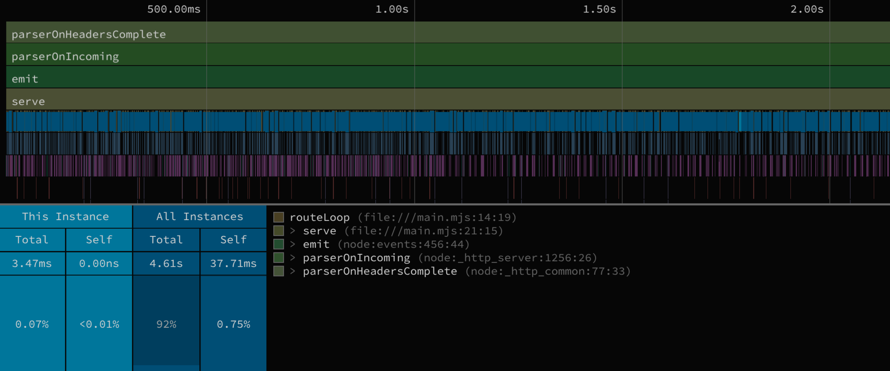

# Event Loop Locks Demo

This project demonstrates a strategy for detecting infinite loops or infinitely blocking functions that cause a Node process to become unresponsive by holding up Node's event loop.

## Use Case

This strategy targets [Node](https://nodejs.org/en) processes that are running in a containerized compute platform that has integrated container lifecycle management that is watching containers and replacing unhealthy containers. In this sample situation, if the Node process becomes stuck and unable to process more [events](https://nodejs.org/learn/asynchronous-work/event-loop-timers-and-nexttick), the container will stop responding to health checks and the container will be replaced. The strategy aims to identify and log what caused it to become stuck without needing to keep the container alive for inspection.

## Strategy

When the container running the Node process is requested to terminate, first probe the process to determine if the container is terminating while the process is healthy. If the process is unhealthy, capture a Node CPU profile using the [Node inspector API](https://nodejs.org/api/inspector.html) and upload it to durable storage. Then terminate the main process and allow the container to exit.

This core strategy is demonstrated in [crash-report.sh](crash-report.sh).

The profile is taken in-process by a worker thread ([profiler-worker.mjs](profiler-worker.mjs)) that connects to the main thread's inspector with `inspector.Session.connectToMainThread()` at startup. No inspector port is ever opened: Node runs with `--disable-sigusr1`, so neither `node inspect -p` nor a `SIGUSR1` can start the unauthenticated debugger on `127.0.0.1:9229`, which any process sharing the container's network namespace (e.g. a sidecar) could otherwise use to run code in the app. The worker is asked to capture a profile through a request file in a private (`0700`) directory created by [entrypoint.sh](entrypoint.sh), and the container runs as the unprivileged `node` user.

The saved CPU profiles can then be inspected to determine which functions were running at the time of termination. Functions contributing to an infinite loop will have consumed most of the CPU time and will be obvious in a flame graph analysis.

## Demonstration

[main.mjs](main.mjs) contains a sample HTTP application that serves `{"ok": true}` to all requests, except if the route is `/loop` in which case the application will loop infinitely and refuse all other requests.

[Dockerfile](Dockerfile) is a minimal build that runs the sample application plus detection tools.

[crash-report.sh](crash-report.sh) will run when the container is requested to terminate. It will generate a crash report that identifies the looping code. This can be triggered with a Ctrl+C after `docker run`.

[entrypoint.sh](entrypoint.sh) exists only to route signals between the container's main process, the Node process, and the inspection program.

[profiler-worker.mjs](profiler-worker.mjs) runs in a worker thread and records the main thread's CPU profile when [crash-report.sh](crash-report.sh) requests it.

## Try it out

Build and run the application. It will listen on localhost:8001. Crash report files will show up in the current directory.
```sh
docker run --rm --user "$(id -u):$(id -g)" --publish 8001:8001 --mount type=bind,src=.,dst=/crash-reports $(docker build --quiet .)
# listening
```

In another terminal, send some sample "good" requests to verify the application is running.
```sh
seq 1 50 | xargs -I_ -n1 -P10 curl http://localhost:8001/ok
# GET /ok
# GET /ok
# ...
```

Send a request that triggers the problematic code.
```sh
curl -v --max-time 5 http://localhost:8001/loop
# GET /loop
```

Terminate the application with a Ctrl+C in the docker terminal and watch it capture a crash report.
```sh
^C
# [ENTRYPOINT] Termination request received.
# [ENTRYPOINT] Service is terminating while unhealthy. Capturing crash report.
# [ENTRYPOINT] Crash report completed.
# [ENTRYPOINT] Terminating main process.
```

Inspect the `node.cpuprofile` file with a flame graph visualizer (try [speedscope.app](https://www.speedscope.app/)). `serve()`, `routeLoop()`, and its called functions will appear in the flame graph as taking up most of the CPU time.

